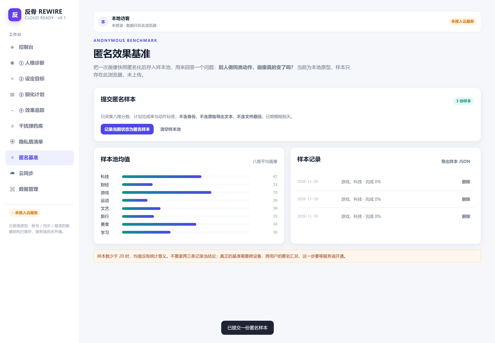

# 反骨 REWIRE · 云就绪版

> `rewire/` 的平行版本：为账号、跨设备同步与匿名效果基准预留完整数据结构和界面。**当前未接入云服务**，全部功能在本地浏览器运行。

## 与本地版的关系

| | 本地版 `rewire/` | 云就绪版 `rewire-cloud/` |
|---|---|---|
| 定位 | 零依赖离线工具，可直接进作品集 | 云端方案的原型，展示可扩展架构 |
| 存储键 | `rewire_state_v1` | `rewire_cloud_state_v1`（互不干扰） |
| 账号 | 无 | 本地访客标识，界面预留 |
| 同步 | JSON 导出/导入 | 本地变更队列（200 条）+ JSON 导出/导入 |
| 效果基准 | 无 | 匿名样本池 + 八维均值 |
| 云服务 | 不需要 | **未接入**；接口与数据结构已就位 |

两版共享同一套人格诊断、目标模板、驯化计划、查询演化、隐私盾、PWA 与提醒逻辑。差异只在账号/同步/基准三块。




## 当前状态（重要）

- 没有服务端，没有账号注册/登录，没有跨设备同步。
- 「账号」仅是本地显示名，不校验身份、不上传。
- 「云同步」页面记录本地变更队列，供将来做增量同步；现在不能真的同步。
- 「匿名基准」样本池只存在当前浏览器，不是跨用户统计；样本数少于 20 时均值无意义。

**没有伪称已上云**：页面上明确标注「未接入云服务」，代码里没有硬编码任何服务端地址或密钥。

## 专有模块

### 云同步页
- 账号栏显示本地访客名与「未登录」状态。
- 自动记录变更到队列：画像更新、目标更新、计划打卡、导入存档、匿名样本、隐私清单。
- 队列上限 200 条，可清空；开通云服务后可作为增量同步依据。
- 同步内容边界写进页面：同步画像/打卡/档案分数与指纹/匿名样本；**不同步**原始导出文本、文件路径、平台账号信息。

### 匿名基准页
- 提交当前画像快照为匿名样本：只留八维分数、日期（精确到天）、计划完成率；不含身份、不含原始文本。
- 样本池均值：八维平均分条形图。
- 样本记录：可单条删除、导出 JSON（便于将来汇总到服务端）。
- 上限 500 份，本地存储。

## 开通云服务的路径（尚未执行）

2026-11-26 尝试开通时被用户取消，因此保持本地实现。若要继续：

1. 在 WorkBuddy 中重新发起云服务授权确认（由界面收集，不在代码里伪造）。
2. 开通后取得前端可用的连接配置；只用服务端给出的配置初始化客户端，不硬编码地址或密钥。
3. 按账号 / 数据库两个模块接入：账号替换本地访客显示，数据库承载画像、计划、档案与匿名样本。
4. 把本地 `syncQueue` 的每条记录映射到云端增量写入；把 `benchSamples` 汇总为跨用户匿名基准。

接入前本版本可正常离线使用，不需要云服务。

## 运行

```bash
# 直接打开
双击 index.html

# 或本地服务（PWA 安装 / 离线缓存需要）
python -m http.server 8000
```

零依赖、无构建步骤。`file://` 下自动跳过 Service Worker 注册，其余功能可用。

## 验证

- 10 个页面导航；账号栏与「未接入云服务」标识。
- 打卡 / 导入 / 提交样本后同步队列计数递增，清空归零。
- 匿名样本提交后八维均值条与记录列表生成，导出 JSON 可下载。
- 无 JS 报错。
- 本地版 `rewire/` 保留 v1.5，未被本版本改动。

## License

MIT © 2026 John-J
