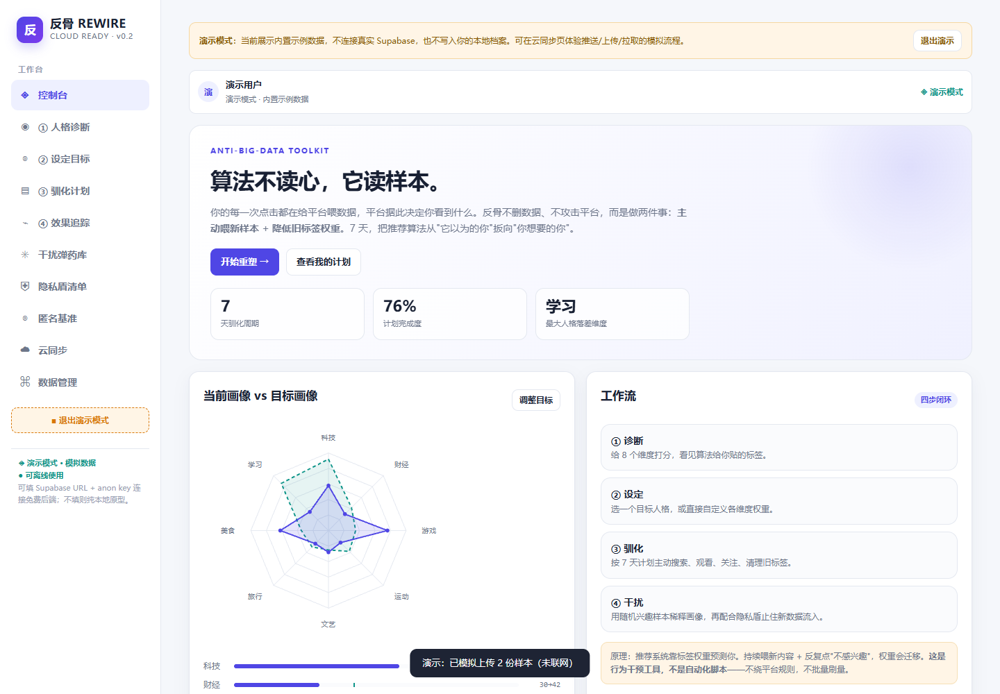
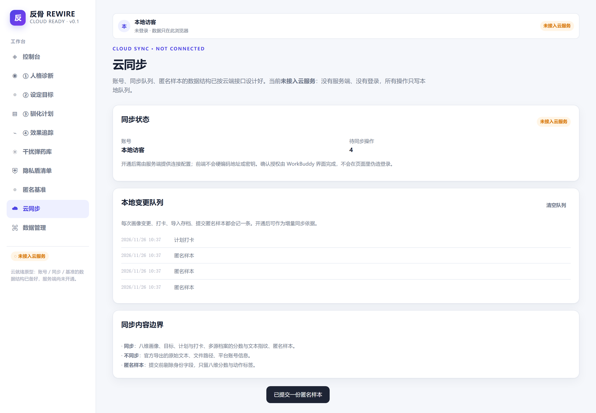

# 反骨 REWIRE · 云就绪版

> `rewire/` 的平行版本：可选接入 Supabase 免费后端，实现变更推送与跨用户匿名基准。不填配置时是纯本地原型。

## 与本地版的关系

| | 本地版 `rewire/` | 云就绪版 `rewire-cloud/` |
|---|---|---|
| 定位 | 零依赖离线工具，可直接进作品集 | 可接免费云后端的扩展版 |
| 存储键 | `rewire_state_v1` | `rewire_cloud_state_v1`（互不干扰） |
| 云端 | 无 | 可选 Supabase（REST，无 SDK） |
| 同步 | JSON 导出/导入 | 本地变更队列 + 可推送到云端 |
| 效果基准 | 无 | 本地样本池 + 可选云端匿名均值 |

两版共享人格诊断、目标模板、驯化计划、查询演化、隐私盾、PWA 与提醒逻辑。差异只在同步/基准三块。

## 演示模式（作品集入口）

不想填密钥也能看完整效果：打开 `index.html?demo=1`，或点侧栏「进入演示模式」。

- 内置一份连贯示例：演示用户、7 天计划（76% 完成）、7 天效果曲线、3 个平台多源档案、演化词统计、6 份本地样本 + 128 份云端均值。
- 云同步页的「推送 / 模拟上传 / 拉取」全部为**模拟**，不发出网络请求；按钮与状态栏都有明确标识。
- 演示数据**纯内存**：不写 localStorage、不污染真实档案；退出演示后恢复原来的本地数据，刷新回到同一份示例。
- 匿名基准页会显示样本量置信度与可复制的邀请文案，说明数据边界和「<20 不作结论」。





## 免费试用 Supabase（5 分钟）

1. 注册 <https://supabase.com>，用 `johnj0706@outlook.com`。**不要绑卡**，用 Free plan。
2. 新建 Project（区域任选，建议离自己近的）；等状态变 Active。
3. 左侧 **SQL Editor → New query**，粘贴本仓库 `supabase-schema.sql` 全部内容，点 Run。建两张表 + RLS 策略。
4. **Project Settings → API Keys**：复制 `Publishable key`（新版 `sb_publishable_...`）或旧版 `anon key`（`eyJ...`）。**不要**用 `Secret keys` / `service_role`。
5. 打开应用 →「云同步」页 → 填 URL + publishable key →「保存并测试连接」。成功即可推送。
6. 打卡/改画像后，点「推送变更队列」；「匿名基准」页点「记录样本」→「上传到云端」→ 云同步页「拉取云端样本均值」。

> ⚠️ 建表时若没勾「Grant API access to new tables automatically」，RLS 策略不会自动给 anon 表权限，REST 会返回 401 `permission denied`。`supabase-schema.sql` 已包含 `GRANT` 语句；已执行过旧版脚本的项目需补跑其中的 GRANT 部分。

**关键安全边界**
- 只填 **anon / public key**。service_role key 可绕过 RLS，绝不贴进前端。anon key 本身是公开可用的，设计如此。
- SQL 已开 RLS：anon 可插入两张表、可读取匿名样本表；**不能读取 sync_events**。
- 云端只存变更摘要（cid/类型/时间）和八维匿名分数。不存原始导出文本、文件路径、平台账号信息。
- `cid` 是浏览器随机生成的匿名标识，不含身份信息。
- 免费项目**闲置 1 周会暂停**，且无自动备份。作品集长期展示请保持活跃或接受临时不可用。

## 免费额度（2026-11 官方页）

| 项 | Supabase Free |
|---|---|
| 数据库 | 500 MB / 项目，2 个活跃项目 |
| 流量 | 5 GB + 5 GB 缓存/月 |
| 认证 | 5 万 MAU（本版未用账号登录） |
| 存储 | 1 GB 文件 |
| 超额 | 硬上限，自动暂停，不按量扣费 |
| 升级 | Pro $25/月起 |

本工具一天几十次读写，免费额度远远够用。

## 专有模块

### 云同步页
- 连接配置：URL + anon key，本地保存；断开即清除。
- 自动记录变更队列：画像、目标、打卡、导入、样本、隐私清单（200 条上限）。
- 「推送变更队列」用 REST `POST /rest/v1/sync_events`，成功后本地标 ✓，用 `(cid,at)` 唯一约束去重。
- 未配置时按钮不可用，所有操作只写本地。

### 匿名基准页
- 提交当前八维画像 + 完成率，日期精确到天，不含身份字段。
- 「上传到云端」`POST /rest/v1/bench_samples`，以 `sample_id` 幂等去重。
- 「拉取云端样本均值」`GET /rest/v1/bench_samples?select=dims`，八维平均。
- 样本量置信度：`<20` 明确标为「只反映小撮偏好差异，不能当结论」；`20–99` 为探索性参考；`≥100` 为初步参考区间，但仍非科学抽样。
- 「复制邀请文案」生成含数据边界与不确定性说明的分享文本，避免把均值包装成结论。
- 本地样本可单删、导出 JSON。

## 技术说明
- **原生 fetch REST**，不引入 Supabase JS SDK，保持单文件零依赖。
- 12 秒请求超时；失败只 toast，不阻断本地功能。
- 配置存在 `localStorage` 的 `state.backend`；`file://` 下也能连接（受浏览器 CORS 影响，建议用 HTTP 本地服务）。
- 代码里没有硬编码地址、密钥或真实数据；唯一的示例数据只在演示模式（`?demo=1`）里生成，且明确标注。

## 运行

```bash
# 直接打开
双击 index.html

# 本地服务（PWA 安装 / 云连接更稳）
python -m http.server 8000
```

零依赖、无构建步骤。`file://` 下自动跳过 Service Worker 注册，其余功能可用。

## 验证

- 10 个页面导航；未连接时上传按钮禁用、标识为「未接入云服务」。
- 用 mock 拦截 `/rest/v1/**`：连接成功 → 队列推送（标 ✓）→ 样本上传（标 ✓）→ 拉取均值（八维正确）→ 断开清空，无 JS 报错。
- 真实 Supabase 项目端到端：连接 → 推送 → 上传样本 → 拉取云端均值 → 八维渲染，无 JS 报错。
- 演示模式端到端（无头 Chrome）：`?demo=1` → 横幅与「演示用户」出现 → 计划 76% → 模拟推送使待推送 2→0 → 模拟上传 → 邀请文案生成 → 退出后恢复「本地访客」且未写入演示存储键，无 JS 报错。
- 本地版 `rewire/` 保留 v1.5，未被本版本改动。

## License

MIT © 2026 John-J
